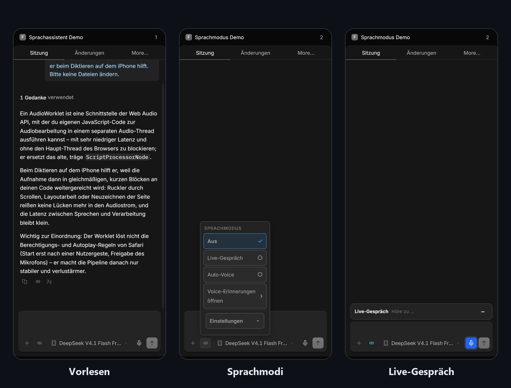
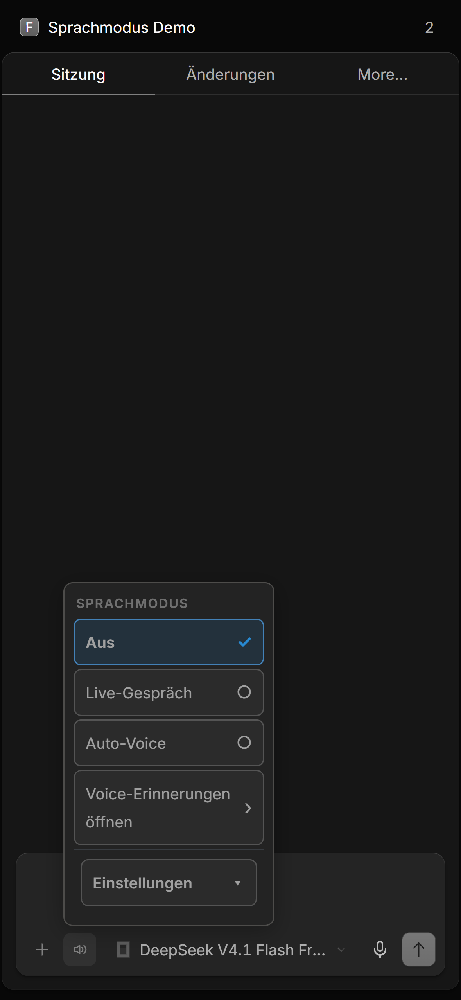

# OC fluffyTouch

**A voice layer for your existing OpenCode session on iPhone.**

OC fluffyTouch adds dictation, read-aloud, and a live conversation to the OpenCode web UI you already run. It does not replace the UI or start a second OpenCode instance. The native chat stays; a local proxy adds the voice features.

<p align="center">
  
  
  
  
</p>

<p align="center">
  <a href="https://github.com/00fLausch/oc-fluffytouch/releases/latest/download/OC-fluffyTouch-Windows.zip">
    
  </a>
</p>

## Screenshots

<p align="center">
  
</p>

*All screenshots show a demo session without private content.*

## At a glance

| Question | Short answer |
| --- | --- |
| **What can it do?** | Dictate, listen to answers, clarify ideas live, and hand off a precise coding task. |
| **What does it look like?** | [Screenshot tour](#screenshots) with read-aloud, voice modes, and live conversation. |
| **How do I install it?** | Unzip, run `.\Install-OCFluffyTouch.ps1`, then `.\Start-OpenCodeTouch.ps1 -Pair`. [Full guide](docs/installation.md). |
| **What is already running?** | OpenCode V2 Desktop on Windows, Tailscale on PC and iPhone, and optional OmniVoice. No second OpenCode. |

## Project status

| Item | State |
| --- | --- |
| **Version** | 0.2.1 |
| **Tests** | 54 Node + 10 Python, passing |
| **Platforms** | Windows 10/11, iPhone/iPad (PWA) |
| **License** | MIT |
| **Open** | Clean-Windows acceptance, real OmniVoice adapter, physical iPhone test |
| **Details** | [Status and limits](#status-and-limits) · [Changelog](CHANGELOG.md) |

## Download

[**Download the Windows ZIP**](https://github.com/00fLausch/oc-fluffytouch/releases/latest/download/OC-fluffyTouch-Windows.zip)

The ZIP contains the guided installer, sources, docs, screenshots, and tests. It does not include OmniVoice, model weights, private voice recordings, credentials, or local configuration.

Requires Windows 10/11, PowerShell 5.1, Node.js 22.13 or newer, Python 3.11 or newer, and OpenCode V2 Desktop for the iPhone mode. [Full requirements](#requirements) · [Installation](docs/installation.md)

## Why OC fluffyTouch?

Coding chat on iPhone is often a compromise: type long instructions, scroll through long answers, and switch between the chat and a voice assistant. OC fluffyTouch closes that gap without leaving the familiar OpenCode UI.

- **Dictate instead of type.** Speak your instruction, watch the live transcript, and keep an editable draft. Nothing is sent until you send it.
- **Listen instead of scroll.** Hear the full answer, pause at any point, and continue. The speaker sits right next to “Copy”.
- **Clarify live instead of rewriting.** Discuss an idea in the live conversation. Only when you explicitly hand off the task does the coding chat receive the precise text.
- **One UI.** No second OpenCode, no replacement frontend, no extra model accounts. The native session, its models, and its files remain the source of truth.

## Quick start

Unzip into a writable folder and open PowerShell in that folder:

```powershell
.\Install-OCFluffyTouch.ps1
```

The installer asks for the target (**Standalone** or **OpenCode**) and the features you want. It reuses existing components, installs missing project packages after asking, and explains the steps for external services. With `-Check` it only validates and writes nothing.

To use the iPhone setup, start the paired private route:

```powershell
.\Start-OpenCodeTouch.ps1 -Pair
```

Open the one-time link directly in Safari on the iPhone. Do not save, share, or redirect it to a cloud service. [Full walkthrough, start commands, and troubleshooting](docs/installation.md).

## Features and benefits

| Feature | What you gain | Requirements |
| --- | --- | --- |
| **Dictation** | Speak long instructions instead of typing, with an editable draft | Python, Parakeet INT8 on CPU |
| **Read-aloud** | Hear answers, pause, resume, stop | Python and a compatible OmniVoice service |
| **Live conversation** | Clarify questions and ideas by voice without leaving the chat | OpenCode integration, dictation, and read-aloud |
| **Coding handoff** | Only the task you explicitly hand off reaches the main chat | Live conversation |
| **Auto-Voice** | Hear a short summary after an answer completes | OpenCode integration and read-aloud |
| **Voice controls** | Query or change voice, profile, model, and thinking by voice | Live conversation |
| **Second opinion** | Get advice without starting the coding chat | Live conversation and an available model |
| **Voice memories** | Keep confirmed preferences across sessions | Live conversation, SQLite, `js-tiktoken` |
| **History log** | Compare timestamps and confirmed steps from main chat and Live | OpenCode integration; Live is optional |

### Dictation

**What it does:** Dictation runs directly in the composer. An AudioWorklet hands audio frames over in small blocks, the partial transcript appears word by word, and the text remains an editable draft after you stop. If you tap Send while recording, the adapter waits for the final text instead of sending half a sentence.

**Why it helps:** You can phrase a coding instruction in one pass without fighting the iPhone keyboard. You see immediately what arrived and can correct the draft before it goes to the chat. A dropped connection leaves the existing dictation in place.

**Requires:** Python and the Parakeet model (INT8, CPU). During installation, the model files can be downloaded from the official source after your approval.

<p align="center">
  
</p>

### Read-aloud

**What it does:** A speaker sits next to “Copy answer”. It reads the complete answer aloud and can be paused, resumed, and stopped. Audio is retained for two newer answers and then cleaned up. Auto-Voice reads a separate short summary and cannot run at the same time as Live.

**Why it helps:** You can listen to long code answers while reading them on screen. You do not have to keep the whole answer in your head or scroll back up. Pause and resume stay at your position.

**Requires:** Python and an OmniVoice-compatible service that returns raw PCM via `POST /tts/stream`. [Set up OmniVoice separately](docs/omnivoice.md).

<p align="center">
  
</p>

### Live conversation

**What it does:** A separate panel next to the main chat captures your voice, shows the current state (“Listening …”, “Waiting for the answer …”), and holds a natural dialogue. The live conversation does not create tasks. It can ask a question, sharpen an idea, or narrow the scope.

**Why it helps:** You clarify what you actually want before sending an unfinished prompt to the coding chat. The main chat stays visible and you can return at any time. A follow-up task can queue while the main session is working.

**Requires:** OpenCode integration, dictation, and read-aloud.

<p align="center">
  
</p>

<p align="center">
  
</p>

### Coding handoff

**What it does:** Only when you explicitly hand off the task does the app send a precise formulation plus the required context to the main chat. The live transcript, private memories, and casual remarks stay out. The app reads back the text that was actually admitted and distinguishes admission, execution, and the substantive answer.

**Why it helps:** The coding chat receives exactly the task you clarified, without conversation noise. You can have an earlier question reused verbatim or refer to the existing message without adding it twice. An offer remains an offer; it is never executed on its own.

**Requires:** Live conversation. [Module boundaries and data flows](docs/module.md).

### Auto-Voice

**What it does:** After an answer completes, Auto-Voice reads a short summary aloud. The output has its own icon and status; the microphone stays off. Auto-Voice and Live cannot run at the same time.

**Why it helps:** You get the core of a long answer without reading it again or starting the speaker manually. The summary is separate from full read-aloud and does not replace it.

**Requires:** OpenCode integration and read-aloud.

### Voice controls and templates

**What it does:** Voice, conversation profile, model, and thinking budget can be queried and explicitly changed by voice. The app reads the selection back and confirms it; mere mentions, quotes, or negations write nothing. You can save a reply style and conversation templates.

**Why it helps:** You do not have to switch to the OpenCode configuration for a different tone. You save the reply style per voice; a template can be activated independently.

**Requires:** Live conversation.

<p align="center">
  
</p>

### Other modules

- **Second opinion:** “Ask the big model” opens an advisory answer from a configurable model. It does not execute a task and does not switch the main chat model.
- **Voice memories:** Confirmed preferences stay local in a SQLite profile, independent of the model. Up to 8,000 tokens, never included in handoffs or expert requests. Confirmation is required by default; for explicitly stated durable preferences, consent can apply per live conversation.
- **History log:** Main chat and live events are stored in a local JSONL with timestamps and message IDs. The log works without Live and has no web read access.
- **Mobile UI without voice:** You can set up the touch adjustments without any voice features. Larger touch targets, 16px inputs against iOS zoom, and a compact composer are included.

## Requirements

- **Windows 10/11** with PowerShell 5.1 as the installer's target platform.
- **Node.js 22.13 or newer** for the proxy and browser adjustments.
- **Python 3.11 or newer** for the voice bridge and dictation.
- **OpenCode V2 Desktop** for the iPhone mode; the native session must already be running.
- **Tailscale** for the private connection; no Funnel and no public remote hosting.
- **OmniVoice** as a separate service for read-aloud; the library, weights, and private voice recordings are not part of the package.

OpenCode updates can change the web UI or the experimental API. There is no blanket version approval. The [verification guide](docs/entwicklung.md) separates module tests from acceptance on a real iPhone.

## Security and data flow

- The proxy binds to **loopback** only and adds same-origin CSS, JavaScript, and AudioWorklet to the native UI. The OpenCode login remains in place.
- The private Tailscale route points to the local proxy, not to a public service. Funnel is excluded.
- The proxy and voice bridge share a random process token; the browser never receives it. Host, origin, and Fetch Metadata checks restrict access.
- Audio, models, memories, and logs stay on the machine. The repository contains no voice recordings, weights, credentials, or local configuration.
- No second OpenCode instance is started. The existing session, its models, and its files remain the source of truth.

## Status and limits

**Version 0.2.1.** 54 Node and 10 Python tests pass. The delivery ZIP is checked for private files, UTF-8, and CRC; the existing private delivery remains separate from publication.

Still open: acceptance on a clean Windows machine, the real model download under Windows PowerShell 5.1, a probe with a real OmniVoice adapter, and the paired iPhone PWA. The local TTS dummy and the static UI tests do not replace those checks.

## Contributing

Bug reports and feature ideas are welcome. Please read [CONTRIBUTING.md](CONTRIBUTING.md) first. For security issues, use [SECURITY.md](SECURITY.md) — do not open a public issue.

## License

The project code is licensed under the [MIT License](LICENSE). Dependencies such as sherpa-onnx, OmniVoice, and OpenCode retain their own licenses.

## Further reading

- [Changelog](CHANGELOG.md)
- [Contributing](CONTRIBUTING.md)
- [Security policy](SECURITY.md)
- [Installation and start](docs/installation.md)
- [Modules, boundaries, and data flows](docs/module.md)
- [Voice Transcript for your own apps](docs/voice-transcript.md)
- [Set up OmniVoice separately](docs/omnivoice.md)
- [Development and verification](docs/entwicklung.md)