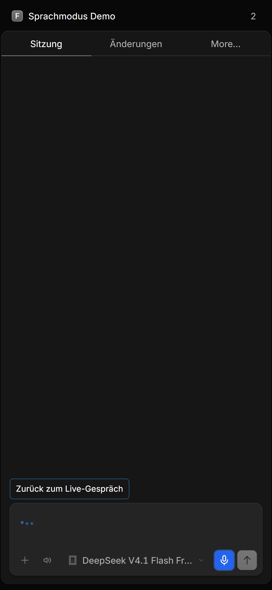
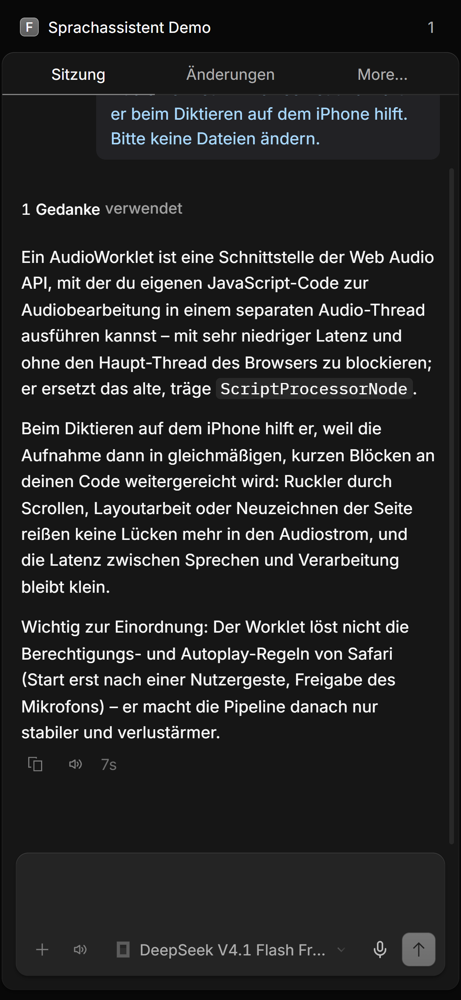
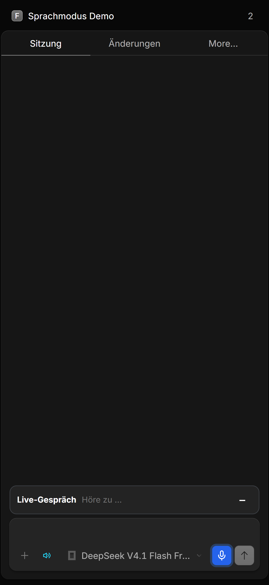
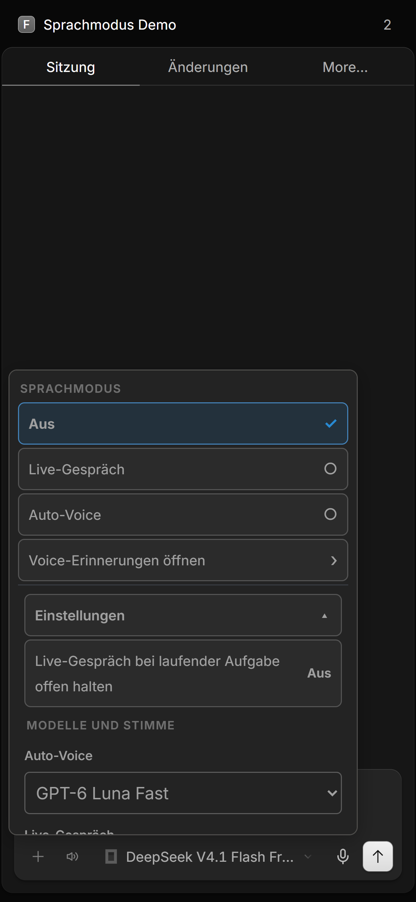

# OC fluffyTouch

**Die Sprachschicht für deine bestehende OpenCode-Sitzung auf dem iPhone.**

OC fluffyTouch ergänzt die OpenCode-Weboberfläche, die bereits läuft, um Diktat, Vorlesen und ein Live-Gespräch. Es ersetzt die Oberfläche nicht und startet keine zweite OpenCode-Instanz. Der native Chat bleibt erhalten; die Sprachfunktionen kommen über einen lokalen Proxy dazu.

<p align="center">
  
</p>

*Alle Screenshots zeigen eine Demo-Sitzung ohne private Inhalte.*

## Warum OC fluffyTouch?

Auf dem iPhone ist ein Coding-Chat schnell ein Kompromiss: lange Anweisungen tippen, lange Antworten scrollen und zwischen Chat und Sprachassistent wechseln. OC fluffyTouch schließt diese Lücke, ohne die gewohnte OpenCode-Oberfläche zu verlassen.

- **Diktieren statt tippen.** Du sprichst deine Anweisung, siehst den Zwischenstand und behältst den editierbaren Entwurf. Gesendet wird erst, wenn du es willst.
- **Vorlesen statt scrollen.** Du hörst die komplette Antwort, pausierst an einer Stelle und setzt fort. Der Sprecher sitzt direkt neben „Kopieren“.
- **Live klären statt umschreiben.** Du besprichst eine Idee im Live-Gespräch. Erst wenn du den Auftrag ausdrücklich übergibst, bekommt der Coding-Chat den präzisen Text.
- **Eine Oberfläche.** Kein zweites OpenCode, kein Ersatz-Frontend, keine zusätzlichen Modellkonten. Die native Sitzung, ihre Modelle und ihre Dateien bleiben.

## Direkt starten

ZIP in einen beschreibbaren Ordner entpacken, PowerShell in diesem Ordner öffnen:

```powershell
.\Install-OCFluffyTouch.ps1
```

Der Installer fragt nach dem Ziel (**Standalone** oder **OpenCode**) und nach den gewünschten Funktionen. Er verwendet vorhandene Komponenten, installiert fehlende Projektpakete nach Rückfrage und nennt die Schritte für externe Dienste. Mit `-Check` prüft er nur, ohne zu schreiben.

Für die iPhone-Nutzung startest du danach die gekoppelte private Route:

```powershell
.\Start-OpenCodeTouch.ps1 -Pair
```

Den angezeigten Einmal-Link direkt in Safari auf dem iPhone öffnen. Nicht speichern, weitergeben oder in eine Cloud umleiten. [Ablauf, Startbefehle und Fehlerhilfe](docs/installation.md).

## Funktionen und Nutzen

| Funktion | Was du gewinnst | Voraussetzung |
| --- | --- | --- |
| **Diktat** | Lange Anweisungen sprechen statt tippen, mit editierbarem Entwurf | Python, Parakeet INT8 auf der CPU |
| **Vorlesen** | Antworten hören, pausieren, fortsetzen, stoppen | Python und ein kompatibler OmniVoice-Dienst |
| **Live-Gespräch** | Fragen und Ideen im Sprachdialog klären, ohne den Chat zu verlassen | OpenCode-Integration, Diktat und Vorlesen |
| **Coding-Übergabe** | Nur der ausdrücklich gewünschte Auftrag landet im Hauptchat | Live-Gespräch |
| **Auto-Voice** | Nach Abschluss eine kurze Zusammenfassung hören | OpenCode-Integration und Vorlesen |
| **Sprachsteuerung** | Stimme, Profil, Modell und Thinking per Sprache abfragen oder ändern | Live-Gespräch |
| **Zweitmeinung** | Beratung einholen, ohne den Coding-Chat zu starten | Live-Gespräch und ein verfügbares Modell |
| **Voice-Erinnerungen** | Bestätigte Vorlieben über Sitzungen hinweg behalten | Live-Gespräch, SQLite, `js-tiktoken` |
| **Verlaufslog** | Zeiten und bestätigte Schritte aus Hauptchat und Live vergleichen | OpenCode-Integration; Live ist optional |

### Diktat

**Was es tut:** Die Spracheingabe läuft direkt im Composer. Ein AudioWorklet übergibt die Audio-Frames in kleinen Blöcken, der Zwischenstand erscheint wortweise, und nach dem Stopp bleibt der Text als bearbeitbarer Entwurf stehen. Wer während der Aufnahme auf Senden tippt, wartet auf den Endtext, statt einen halben Satz abzuschicken.

**Warum es hilft:** Du formulierst eine Coding-Anweisung in einem Zug, ohne auf der iPhone-Tastatur zu kämpfen. Du siehst sofort, was ankam, und kannst den Entwurf korrigieren, bevor er in den Chat geht. Ein Verbindungsabbruch lässt den bisherigen Text stehen.

**Braucht:** Python und das Parakeet-Modell (INT8, CPU). Die Modelldateien können bei der Installation nach deiner Zustimmung aus der offiziellen Quelle geladen werden.

<p align="center">
  
</p>

### Vorlesen

**Was es tut:** Neben „Antwort kopieren“ sitzt ein Sprecher. Er liest die komplette Antwort vor, lässt sich pausieren, fortsetzen und stoppen. Das Audio bleibt für zwei neuere Antworten erhalten; danach wird es aufgeräumt. Auto-Voice liest eine separate kurze Zusammenfassung und ist nicht gleichzeitig mit Live aktiv.

**Warum es hilft:** Lange Code-Antworten lassen sich hören, während du sie auf dem Bildschirm liest. Du musst nicht die ganze Antwort im Kopf behalten oder erneut hochscrollen. Pausieren und Fortsetzen bleiben an deiner Stelle.

**Braucht:** Python und einen OmniVoice-kompatiblen Dienst, der rohes PCM über `POST /tts/stream` liefert. [OmniVoice separat einrichten](docs/omnivoice.md).

<p align="center">
  
</p>

### Live-Gespräch

**Was es tut:** Ein eigenes Panel neben dem Hauptchat nimmt deine Sprache auf, zeigt den Stand („Höre zu …“, „Warte auf fertige Antwort …“) und führt einen natürlichen Dialog. Das Live-Gespräch erzeugt keine Aufträge. Es kann eine Frage stellen, eine Idee präzisieren und auf einen Punkt begrenzen.

**Warum es hilft:** Du klärst erst im Gespräch, was du eigentlich willst, statt einen unfertigen Prompt in den Coding-Chat zu schicken. Der Hauptchat bleibt sichtbar; du kannst jederzeit zurückwechseln. Ein Folgeauftrag kann in die Queue gehen, während die Hauptsitzung arbeitet.

**Braucht:** OpenCode-Integration, Diktat und Vorlesen.

<p align="center">
  
</p>

<p align="center">
  
</p>

### Coding-Übergabe

**Was es tut:** Nur wenn du den Auftrag ausdrücklich übergibst, schickt die App eine präzise Formulierung plus den nötigen Kontext an den Hauptchat. Die Live-Mitschrift, private Erinnerungen und beiläufige Bemerkungen bleiben draußen. Die App liest den tatsächlich angenommenen Text vor und unterscheidet Annahme, Ausführung und inhaltliche Antwort.

**Warum es hilft:** Der Coding-Chat bekommt genau die Aufgabe, die du geklärt hast, und keinen Gesprächsmüll. Du kannst eine frühere Frage wörtlich übernehmen lassen oder auf die vorhandene Nachricht verweisen, ohne sie doppelt einzureihen. Ein Angebot zum Auftrag bleibt ein Angebot; es wird nie von selbst ausgeführt.

**Braucht:** Live-Gespräch. [Modulgrenzen und Datenflüsse](docs/module.md).

### Auto-Voice

**Was es tut:** Nach Abschluss einer Antwort liest Auto-Voice eine kurze Zusammenfassung vor. Die Ausgabe hat ein eigenes Symbol und einen eigenen Status; das Mikrofon bleibt aus. Auto-Voice und Live können nicht gleichzeitig laufen.

**Warum es hilft:** Du bekommst den Kern einer langen Antwort mit, ohne sie erneut zu lesen oder den Sprecher manuell zu starten. Die Zusammenfassung ist vom vollständigen Vorlesen getrennt und ersetzt es nicht.

**Braucht:** OpenCode-Integration und Vorlesen.

### Sprachsteuerung und Vorlagen

**Was es tut:** Stimme, Gesprächsprofil, Modell und Thinking Budget lassen sich per Sprache abfragen und ausdrücklich ändern. Die App liest die Auswahl zurück und bestätigt sie; bloße Erwähnungen, Zitate oder Verneinungen schreiben nichts. Für jede Stimme lassen sich Antwortstil und Gesprächsvorlagen speichern.

**Warum es hilft:** Du musst für eine andere Tonalität nicht in die OpenCode-Konfiguration wechseln. Den Antwortstil speicherst du pro Stimme; eine Vorlage lässt sich unabhängig davon aktivieren.

**Braucht:** Live-Gespräch.

<p align="center">
  
</p>

### Weitere Module

- **Zweitmeinung:** „Frag das große Modell“ öffnet eine beratende Antwort über ein konfigurierbares Modell. Sie führt keinen Auftrag aus und wechselt nicht das Modell des Hauptchats.
- **Voice-Erinnerungen:** Bestätigte Vorlieben bleiben lokal in einem SQLite-Profil, unabhängig vom Modell. Maximal 8.000 Tokens, keine Aufnahme in Übergaben oder Expertenanfragen. Standardmäßig ist eine Bestätigung nötig; für ausdrücklich genannte dauerhafte Vorlieben kann die Zustimmung pro Live-Gespräch gelten.
- **Verlaufslog:** Hauptchat und Live-Ereignisse landen mit Zeitstempel und Nachrichten-ID in einem lokalen JSONL. Das Log ist auch ohne Live nutzbar und hat keinen Web-Lesezugriff.
- **Mobile Oberfläche ohne Sprache:** Du kannst die Touch-Anpassungen auch ohne Sprachfunktionen einrichten. Größere Touch-Ziele, 16px-Inputs gegen iOS-Zoom und ein kompakter Composer gehören dazu.

## Voraussetzungen

- **Windows 10/11** mit PowerShell 5.1 als Zielplattform des Installers.
- **Node.js 22.13 oder neuer** für Proxy und Browser-Anpassung.
- **Python 3.11 oder neuer** für die Sprachbrücke und das Diktat.
- **OpenCode V2 Desktop** für den iPhone-Modus; die native Sitzung muss bereits laufen.
- **Tailscale** für die private Verbindung; kein Funnel und kein öffentliches Remote-Hosting.
- **OmniVoice** als separater Dienst für das Vorlesen; die Bibliothek, Gewichte und private Stimmen gehören nicht zum Paket.

OpenCode-Updates können Weboberfläche oder experimentelle API ändern. Es gibt keine pauschale Versionsfreigabe. Die [Prüfanleitung](docs/entwicklung.md) trennt Modultests von der Abnahme auf einem echten iPhone.

## Sicherheit und Datenfluss

- Der Proxy bindet nur auf **Loopback** und ergänzt die native Oberfläche um same-origin CSS, JavaScript und AudioWorklet. Die OpenCode-Anmeldung bleibt erhalten.
- Die private Tailscale-Route zeigt auf den lokalen Proxy, nicht auf einen öffentlichen Dienst. Funnel ist ausgeschlossen.
- Proxy und Sprachbrücke teilen sich ein zufälliges Prozess-Token; der Browser bekommt es nicht. Host-, Origin- und Fetch-Metadata-Prüfungen begrenzen den Zugriff.
- Audio, Modelle, Erinnerungen und Logs bleiben auf dem Rechner. Das Repository enthält keine Sprachaufnahmen, Gewichte, Zugangsdaten oder lokalen Konfigurationen.
- Es wird keine zweite OpenCode-Instanz gestartet. Die vorhandene Sitzung, ihre Modelle und ihre Dateien bleiben die Quelle der Wahrheit.

## Stand und Grenzen

**Version 0.2.1.** 54 Node- und 10 Python-Tests sind grün. Die Auslieferungs-ZIP wird auf private Dateien, UTF-8 und CRC geprüft; die bestehende private Auslieferung bleibt von der Veröffentlichung getrennt.

Offen sind die Abnahme auf einem sauberen Windows-System, der echte Modell-Download unter Windows PowerShell 5.1, die Probe mit einem echten OmniVoice-Adapter und die gekoppelte iPhone-PWA. Der lokale TTS-Dummy und die statischen Oberflächentests ersetzen diese Nachweise nicht.

## Lizenz

Der Projektcode steht unter der [MIT-Lizenz](LICENSE). Abhängigkeiten wie sherpa-onnx, OmniVoice und OpenCode behalten ihre eigenen Lizenzen.

## Weiterlesen

- [Installation und Start](docs/installation.md)
- [Module, Grenzen und Datenflüsse](docs/module.md)
- [Voice Transcript für eigene Apps](docs/voice-transcript.md)
- [OmniVoice separat einrichten](docs/omnivoice.md)
- [Entwicklung und Prüfung](docs/entwicklung.md)